# Codex2API Logo & Brand Concept Archive

本文档归档 Codex2API 品牌 Logo、浅/深色图标适配及多轮视觉探索方案，便于后续迭代、宣传物料复用或二次设计参考。

---

## 最终采用方案（Adopted Identity）

最终采用 **3D 磨砂玻璃三层堆叠 `>_`** 作为独立品牌徽标（居中紧裁放大至约 86% 主体占比），并配对浅色 / 深色双版本图标与 README 双主题横幅：

| 深色模式 Logo | 浅色模式 Logo | 深色 Favicon | 浅色 Favicon |
| :---: | :---: | :---: | :---: |
| 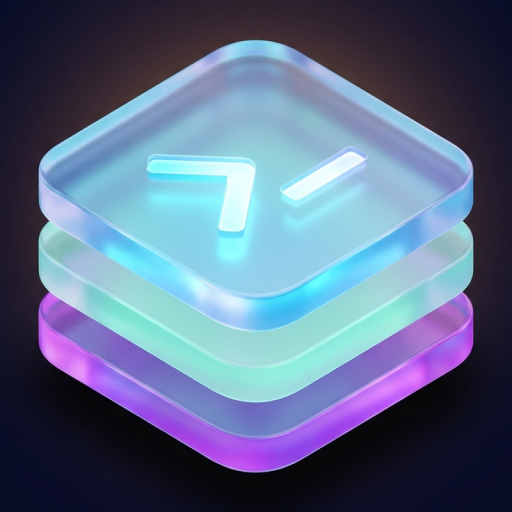 | 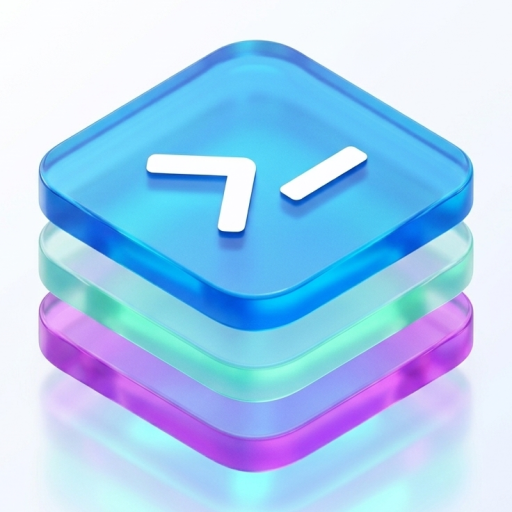 | 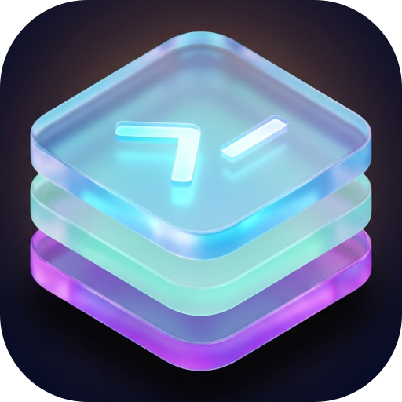 | 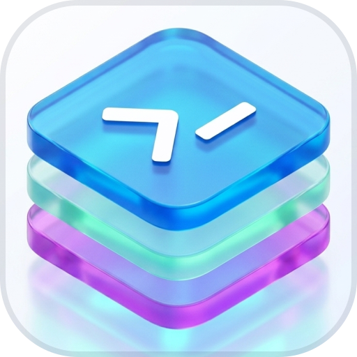 |

---

## Round 1 · 多风格初探（极简几何 / 3D 玻璃 / 赛博网关 / 流体光带）

| 方案 A · 极简几何终端网关 | 方案 B · 3D 磨砂玻璃堆叠（最终原型） | 方案 C · 赛博网格脉冲网关 | 方案 D · 流体光带桥接 |
| :---: | :---: | :---: | :---: |
| 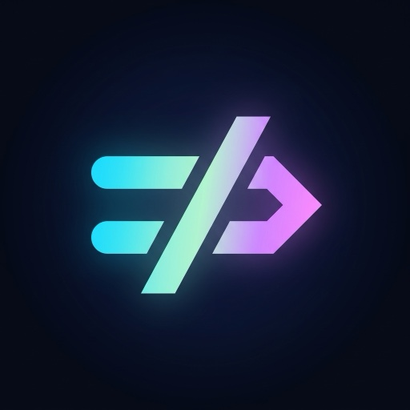 | 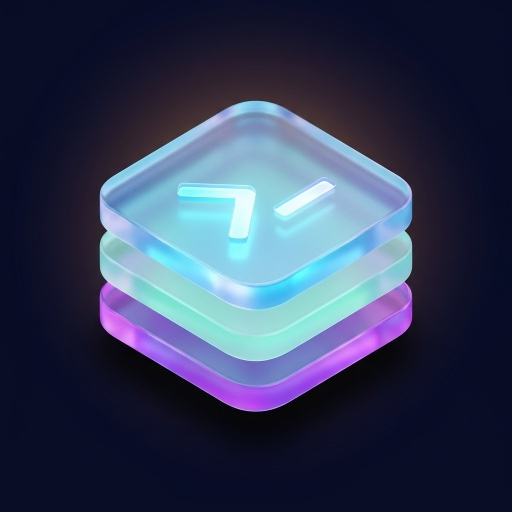 | 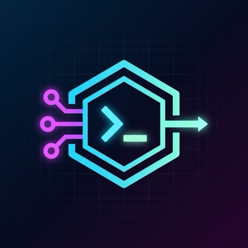 | 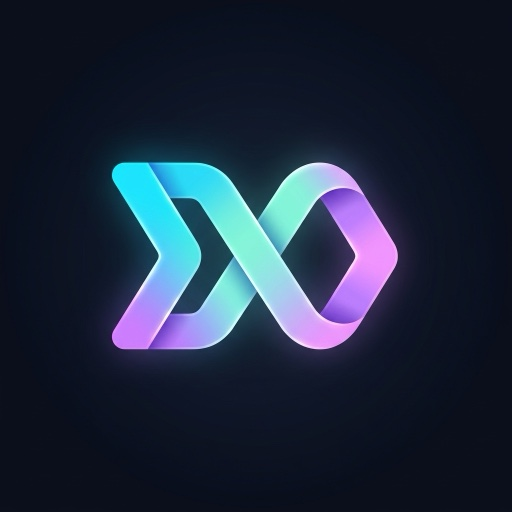 |

---

## Round 2 · 方案 B 融合渠道图标（v2：Codex + Claude / Antigravity / Grok / Kiro）

| 方案 B1 · 环绕玻璃徽章 | 方案 B2 · 统一等距 3D 玻璃晶片 | 方案 B3 · 活力极光悬浮卡片 |
| :---: | :---: | :---: |
| 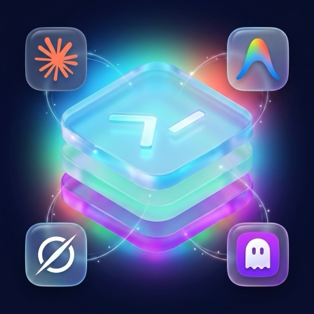 | 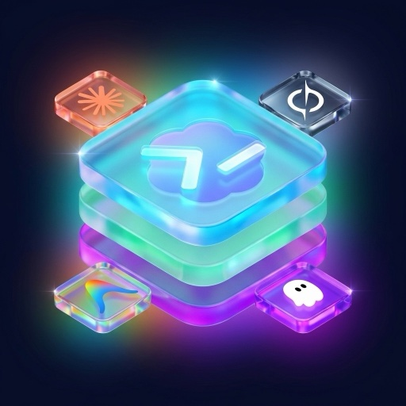 | 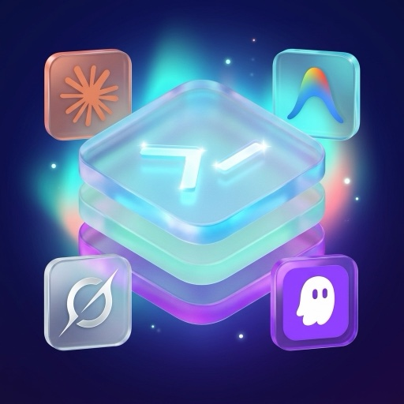 |

---

## Round 3 · 方案 B 融合全 6 渠道图标（v3：加入 OpenCode）

| 方案 B1-v3 · 五星环绕轨道 | 方案 B2-v3 · 等距 3D 晶片 | 方案 B3-v3 · 活力极光卡片 |
| :---: | :---: | :---: |
| 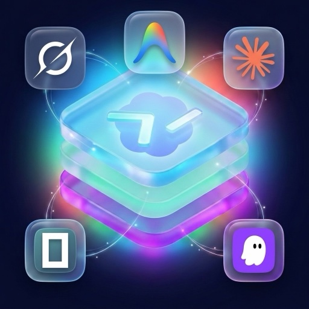 | 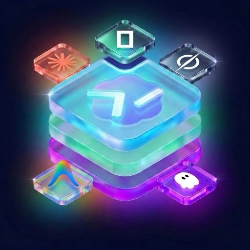 | 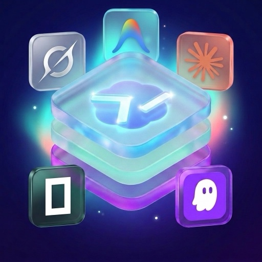 |

---

## Round 4 · 独立 AI 网关代理视觉（无第三方渠道图标）

| 方案 G1 · 3D 折射棱镜网关 | 方案 G2 · 3D 水晶网关传送门 | 方案 G3 · 3D 液态玻璃神经路由核 |
| :---: | :---: | :---: |
| 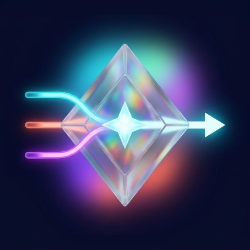 | 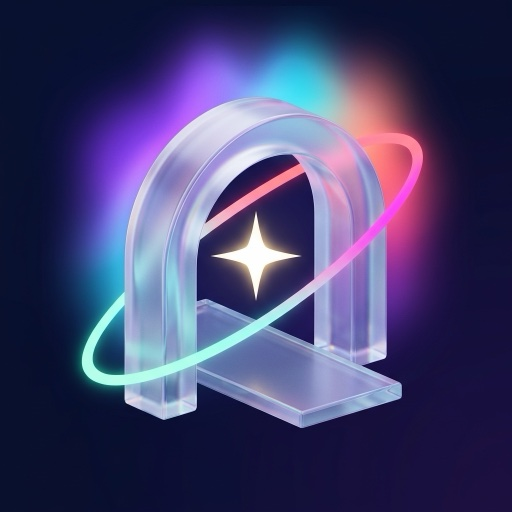 | 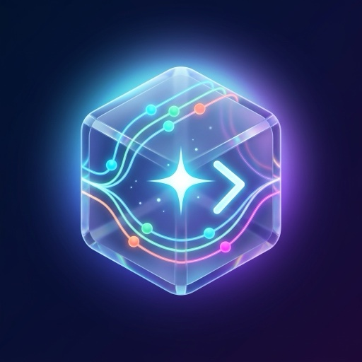 |

---

## Round 5 · 方案 G3 创意进阶延展

| 方案 G3-A · 裂变悬浮魔方 | 方案 G3-B · 莫比乌斯折跃立方 | 方案 G3-C · 霓虹星轨宇宙 | 方案 G3-D · 全息液态光核魔盒 |
| :---: | :---: | :---: | :---: |
| 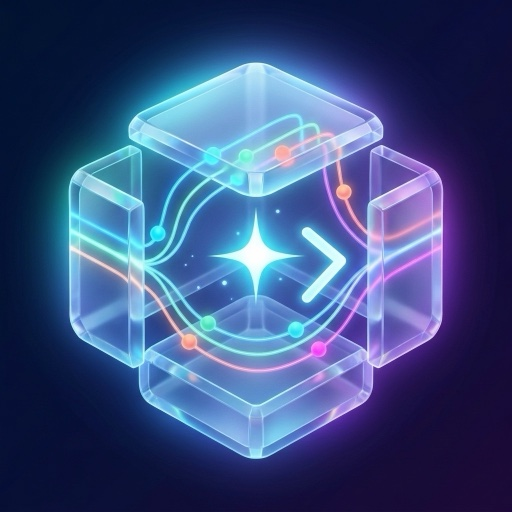 | 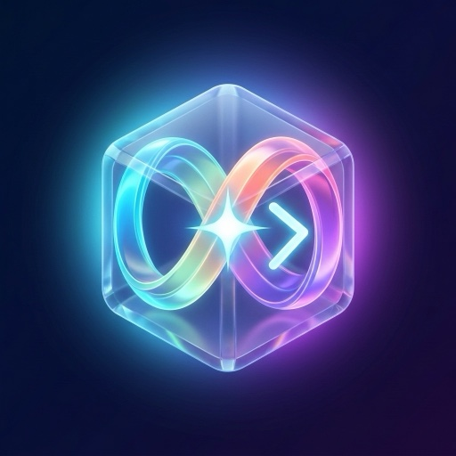 | 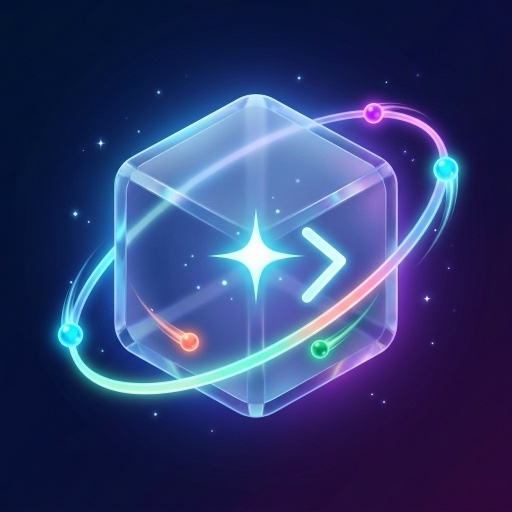 | 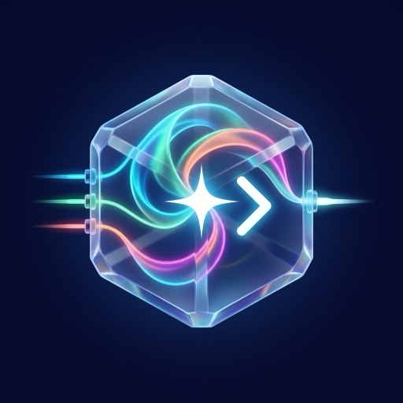 |

---

## 浅色模式配对探索（Light-Mode Counterparts）

| 浅色方案 1 · 柔和珍珠白 | 浅色方案 2 · 高对比晴空蓝（最终采用） |
| :---: | :---: |
| 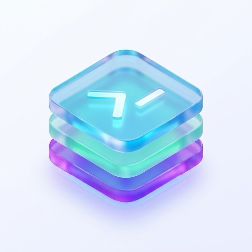 | 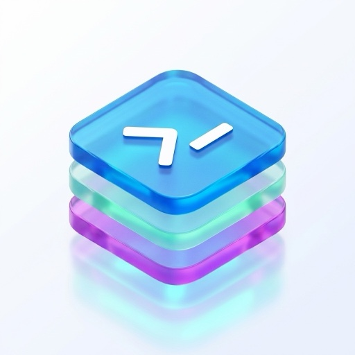 |
